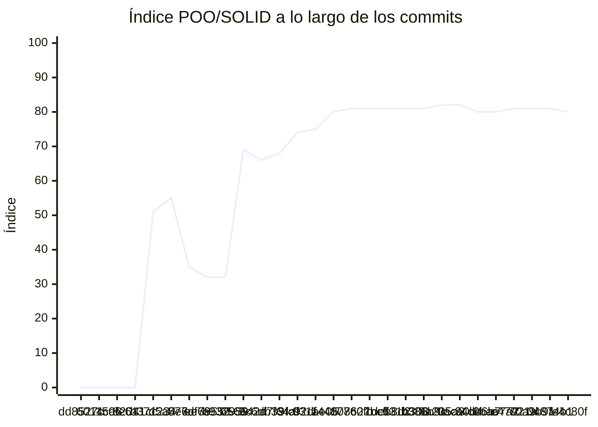

<!-- evaluacion:inicio -->
# Evaluación — organizacion-sonica/proyecto-fisica

> Documento **generado automáticamente** por la cátedra de Programación II (RepoSense + análisis de calidad POO/SOLID). **No editar a mano**: se regenera en cada evaluación.
> Rama evaluada: `main`. Análisis **heurístico** (regex + métricas): es una criba para orientar la revisión, **no una nota**.
> Generado: 2026-11-14.

## 1. Veredicto

| Aspecto | Resultado |
|---|---|
| Índice de calidad POO/SOLID | **80/100** |
| Código (LOC) | 3,576 |
| Archivos de código | 67 |
| Clases (bien usadas) | 80 (32 OK) |
| Código dentro de clases (%POO) | 96% |
| Funciones fuera de clases | 0 |
| Duplicación lógica | 1.8% |
| Señales S/O/L/I/D | 7/0/0/0/6 |

> Este informe **describe** lo que el análisis midió con los criterios ya establecidos de la materia. No es una nota.

### Semáforo de aprobación

Criterios de `CRITERIOS-CALIDAD.md`. **Aprobar** se juega con el perfil `estandar`; **destacar**, con el `exigente` (meta de excelencia).

| Semáforo | Resultado |
|---|---|
| Aprobar (`estandar`) | **no cumple** — 3/4 |
| Destacar (`exigente`) | **no cumple** — 4/5 |

**Criterios para aprobar**

| Criterio | Requisito | Tu resultado | Cumple |
|---|---|---|---|
| Código dentro de clases (%POO) | ≥ 85% | 96% | sí |
| Duplicación lógica | ≤ 10% | 1.8% | sí |
| Funciones fuera de clases | ≤ 1 | 0 | sí |
| Señales POO/SOLID críticas | ninguna | Acoplamiento alto (CBO) | no |

**Criterios para destacar**

| Criterio | Requisito | Tu resultado | Cumple |
|---|---|---|---|
| Código dentro de clases (%POO) | ≥ 95% | 96% | sí |
| Duplicación lógica | ≤ 5% | 1.8% | sí |
| Funciones fuera de clases | ≤ 1 | 0 | sí |
| Señales POO/SOLID críticas | ninguna | Clase demasiado grande (SRP), Baja cohesión (LCOM), Acoplamiento alto (CBO) | no |
| Índice de calidad POO/SOLID | ≥ 60 | 80/100 | sí |

### Cómo se calcula el %POO (y por qué no sube solo)

`%POO = líneas de lógica dentro de clases ÷ líneas de lógica totales`.

Se cuentan las líneas de **lógica y campos**; no cuentan `package`/`import`/`using`/anotaciones ni comentarios, Javadoc o docstrings. Es una **proporción**: si agregás código nuevo dentro de una clase, el numerador y el denominador crecen juntos y el porcentaje casi no cambia.

Sube cuando el código que hoy está **fuera** de clases pasa a ser método de una clase (o desaparece): funciones sueltas, `main`, constantes de módulo, scripts y lógica de archivos sueltos. También importa que ese trabajo esté **integrado en `main`**: la evaluación siempre mide `main`, así que lo que sigue en otra rama no se refleja todavía.

## 2. Autoría (RepoSense)

| Autor | Commits | Código (LOC) | Tests (LOC) | Docs (LOC) | Días activos | % del código |
|---|---:|---:|---:|---:|---:|---:|
| simonK2010 | 31 | 4,153 | 76 | 14 | 16 | 100% |

> _El LOC de autoría lo calcula RepoSense sobre el historial y puede diferir del LOC de código del análisis de calidad (que mira solo el estado de `main`)._

## 3. Fallas detectadas

Reúne lo que el análisis marcó y lo que todavía falta para cada semáforo. Cuando la señal se puede asociar a archivos, se indican para orientar la revisión. No es una nota.

| Falla | Tu resultado | Requisito | Archivos |
|---|---|---|---|
| Señales POO/SOLID críticas | Acoplamiento alto (CBO) | Aprobar: ninguna Destacar: ninguna | `app/src/main/kotlin/org/example/BasketGameController.kt`, `app/src/main/kotlin/org/example/BirdPile.kt`, `app/src/main/kotlin/org/example/Box2DWorld.kt`, `app/src/main/kotlin/org/example/GameController.kt`, `app/src/main/kotlin/org/example/MenuController.kt`, `app/src/main/kotlin/org/example/SlingshotDefaults.kt` (+3 más) |
| Métodos/funciones largos o con muchos parámetros | **3** método(s)/función(es) largos o con muchos parámetros | Sin señales | `app/src/main/kotlin/org/example/ExplosionForce.kt` |
| Dependencia de concretos y falta de abstracciones (DIP) | **6** dependencia(s) de concretos sin abstracciones | Sin señales | `app/src/main/kotlin/org/example/BirdSuppliers.kt`, `app/src/main/kotlin/org/example/HitboxFactory.kt`, `app/src/main/kotlin/org/example/SlingshotApp.kt`, `app/src/main/kotlin/org/example/SlingshotDefaults.kt`, `app/src/main/kotlin/org/example/TargetFactory.kt`, `app/src/test/kotlin/org/example/AppTest.kt` |
| Campos públicos (encapsulación) | **12** clase(s) con campos públicos | Sin señales | `app/src/main/kotlin/org/example/BasketHoop.kt`, `app/src/main/kotlin/org/example/Bird.kt`, `app/src/main/kotlin/org/example/Bomb.kt`, `app/src/main/kotlin/org/example/Chuck.kt`, `app/src/main/kotlin/org/example/EntityView.kt`, `app/src/main/kotlin/org/example/GameEntity.kt` (+6 más) |

## 4. Aspectos evaluados

Cada aspecto indica **qué mide**, **por qué importa** y **tu resultado**. Cuando el análisis reportó una señal, se agregan preguntas para **investigar la causa** (no hay recetas: entender el porqué es parte de la evaluación).

### 1. Índice de calidad POO/SOLID (indice)

- **Qué mide:** Un resumen numérico (0-100) que combina la riqueza de clases bien usadas con la penalización por señales POO/SOLID y duplicación, y luego aplica topes duros.
- **Por qué importa:** Ordena y prioriza la revisión: un índice bajo indica varias señales que conviene mirar juntas.
- **Tu resultado:** índice **80/100**

### 2. Duplicación lógica (DRY) (duplicacion) — sin señales

- **Qué mide:** Porcentaje de bloques de LÓGICA repetidos. Quedan fuera imports/includes, anotaciones, declaraciones de campos y comentarios/Javadoc/docstrings: esos bloques son boilerplate, no lógica.
- **Por qué importa:** Cada copia de lógica se mantiene por separado: un arreglo hay que repetirlo y los defectos se multiplican.
- **Tu resultado:** **1.8%** de duplicación lógica

### 3. Adopción de POO (% de código en clases) (poo) — sin señales

- **Qué mide:** Proporción de las **líneas de lógica** que viven dentro de una clase. Quedan fuera `package`/`import`/`using`/anotaciones y comentarios/Javadoc/docstrings: no son código que pueda estar dentro de una clase y, si contaran, el porcentaje quedaría topado por el boilerplate de cada archivo.
- **Por qué importa:** El diseño orientado a objetos es el eje de la materia: el comportamiento debería vivir como método de una clase.
- **Tu resultado:** **96.5%** del código dentro de clases
- **Cómo leerlo:** Es una **proporción**, no un acumulado: agregar código dentro de una clase no la sube por sí solo (numerador y denominador crecen juntos). Sube cuando el código que está **fuera** de clases (funciones sueltas, `main`, constantes de módulo, scripts) pasa a ser método de una clase o deja de existir. La medición se hace sobre `main`: el trabajo que todavía vive en otra rama no se refleja hasta que se integra.

### 4. Funciones fuera de clases (sueltas) — sin señales

- **Qué mide:** Funciones de nivel de módulo que no pertenecen a ninguna clase (en esta materia el comportamiento debe ser método de una clase).
- **Por qué importa:** Son la forma más directa de código procedural en un proyecto que debería ser orientado a objetos.
- **Tu resultado:** **0** función(es) fuera de clases

### 5. Clase demasiado grande (SRP) (god) — con señales

- **Qué mide:** Clases con demasiadas líneas o métodos de LÓGICA. No cuentan los getters/setters triviales ni la cantidad de campos por sí sola.
- **Por qué importa:** Una clase que hace de todo cambia por muchos motivos y cuesta entenderla y probarla.
- **Tu resultado:** **1** clase(s) demasiado grande(s)
- **Para investigar la causa:**
    - ¿La clase creció por acumulación de responsabilidades?
    - ¿Qué partes de la clase se usan siempre juntas y cuáles no?
    - ¿Se podría describir su responsabilidad en una sola frase?

### 6. Baja cohesión (LCOM) (cohesion) — con señales

- **Qué mide:** Métodos y campos de una clase que casi no se relacionan entre sí.
- **Por qué importa:** Una unidad que cambia por motivos distintos y comparte poca información suele esconder más de una responsabilidad.
- **Tu resultado:** **7** clase(s) con baja cohesión
- **Para investigar la causa:**
    - ¿Qué métodos de la clase no comparten estado con el resto?
    - ¿Cambian por motivos distintos según la tarea?
    - ¿Se pensó su responsabilidad antes de escribirla, o se fue agregando?

### 7. Complejidad alta (complejidad) — sin señales

- **Qué mide:** Complejidad ciclomática: cantidad de caminos posibles dentro de un método o función (condicionales, bucles, casos).
- **Por qué importa:** Muchos caminos = difícil de seguir y de probar; suelen esconderse casos sin cubrir.
- **Tu resultado:** **0** método(s)/función(es) con complejidad alta

### 8. Métodos/funciones largos o con muchos parámetros (tamano) — con señales

- **Qué mide:** Tamaño de los métodos/funciones y cantidad de parámetros.
- **Por qué importa:** Una función que hace varias cosas cuesta leerla, nombrarla y reutilizarla.
- **Tu resultado:** **3** método(s)/función(es) largos o con muchos parámetros
- **Para investigar la causa:**
    - ¿La función creció por acumulación de pasos?
    - ¿Agrupa operaciones que podrían describirse por separado?
    - ¿Los parámetros representan una misma idea (un objeto) o cosas sueltas?

### 9. Acoplamiento alto (CBO) (acoplamiento) — con señales

- **Qué mide:** Cuánto depende una clase de otros tipos del proyecto. No cuentan los tipos de la plataforma (biblioteca estándar, DOM, motor Godot) ni los métodos/propiedades propias.
- **Por qué importa:** Piezas muy enlazadas hacen que un cambio se propague y que sea difícil reemplazar partes.
- **Tu resultado:** **6** clase(s) muy acoplada(s)
- **Para investigar la causa:**
    - ¿La clase conoce detalles internos de muchas otras?
    - ¿Se puede cambiar una parte sin tocar las demás?
    - ¿Los colaboradores llegan como parámetros o se crean por dentro?

### 10. Herencia profunda (DIT) (herencia) — sin señales

- **Qué mide:** Profundidad de la cadena de herencia de una clase.
- **Por qué importa:** Jerarquías muy profundas vuelven difícil saber de dónde viene cada comportamiento.
- **Tu resultado:** **0** clase(s) con herencia profunda

### 11. Switch sobre tipos (OCP) (ocp) — sin señales

- **Qué mide:** Cadenas de dispatch por tipo (`else if ... is` / `else if ... instanceof`, `switch` sobre tipo o `typeof`). Un `is Tipo variable` aislado (pattern matching / cast seguro) NO cuenta como switch.
- **Por qué importa:** Cada tipo nuevo obliga a tocar varios lugares, en vez de extender con una implementación nueva.
- **Tu resultado:** **0** clase(s) con switch sobre tipos

### 12. Interfaz con demasiados métodos (ISP) (isp) — sin señales

- **Qué mide:** Interfaces o clases abstractas con muchos métodos declarados.
- **Por qué importa:** Obliga a implementar operaciones que no se usan y acopla a los clientes a métodos que no necesitan.
- **Tu resultado:** **0** interfaz(es) con demasiados métodos

### 13. Override vacío o 'no implementado' (LSP) (lsp) — sin señales

- **Qué mide:** Métodos sobrescritos que quedan vacíos o lanzan 'no implementado'.
- **Por qué importa:** Suele indicar que la jerarquía no representa bien el problema y rompe la sustitución entre clases.
- **Tu resultado:** **0** override(s) vacío(s) o 'no implementado'

### 14. Dependencia de concretos y falta de abstracciones (DIP) (dip) — con señales

- **Qué mide:** Instanciación directa de clases **propias** concretas y ausencia de interfaces o clases abstractas pese al acoplamiento. No cuentan los structs ni los nodos/tipos del motor.
- **Por qué importa:** Depender de implementaciones concretas dificulta cambiar o probar una parte sin arrastrar las demás.
- **Tu resultado:** **6** dependencia(s) de concretos sin abstracciones
- **Para investigar la causa:**
    - ¿La clase crea por dentro a sus colaboradores en vez de recibirlos?
    - ¿Hay puntos de variación que convendría expresar como abstracción?
    - ¿Cómo se probaría esa clase cambiando una implementación?

### 15. Clase sin métodos (solo datos) (data) — sin señales

- **Qué mide:** Clases que solo acumulan campos y no tienen comportamiento.
- **Por qué importa:** Separar datos de comportamiento reparte por el proyecto la lógica que debería estar cerca de esos datos.
- **Tu resultado:** **0** clase(s) sin métodos (solo datos)

### 16. Campos públicos (encapsulación) (encapsulacion) — con señales

- **Qué mide:** Clases que exponen campos sin control de acceso.
- **Por qué importa:** Expone el estado interno y hace que cualquier cambio dependa de quién lo modifica desde afuera.
- **Tu resultado:** **12** clase(s) con campos públicos
- **Para investigar la causa:**
    - ¿Se accede al campo desde otras clases para evitar un método?
    - ¿Qué reglas deberían respetarse al modificar ese estado?
    - ¿Los campos públicos se usan más como configuración que como estado?

### 17. Clase solo con métodos estáticos (utilitaria) (static) — sin señales

- **Qué mide:** Clases donde todos los métodos son estáticos.
- **Por qué importa:** Es comportamiento procedural disfrazado de clase: no se instancia ni participa del modelo de objetos.
- **Tu resultado:** **0** clase(s) solo con métodos estáticos

## 5. Evolución por commit

Métricas calculadas sobre el estado de `main` en **cada commit** (28 commits con trabajo), del primero al último. La calidad usa el perfil `exigente`; el aporte de código lo mide RepoSense. El índice puede **bajar** al crecer el proyecto: se acumulan señales.

| # | Fecha | Commit | Autor | LOC | Índice | %POO | Duplic. | Sueltas |
|---|---|---|---|---:|---:|---:|---:|---:|
| 1 | 2026-08-14 | `dd8527c` | simonK2010 | 0 | 0 | 0% | 0.0% | 0 |
| 2 | 2026-08-24 | `6011506` | dqmdz-etec | 0 | 0 | 0% | 0.0% | 0 |
| 3 | 2026-09-28 | `4cafe61` | simonK2010 | 0 | 0 | 0% | 0.0% | 0 |
| 4 | 2026-09-28 | `82041cc` | simonK2010 | 0 | 0 | 0% | 0.0% | 0 |
| 5 | 2026-09-28 | `b371234` | simonK2010 | 1,539 | 51 | 89% | 4.4% | 0 |
| 6 | 2026-10-09 | `d5a0e6c` | simonK2010 | 2,087 | 55 | 95% | 4.3% | 0 |
| 7 | 2026-10-23 | `577df69` | simonK2010 | 2,512 | 35 | 96% | 16.4% | 0 |
| 8 | 2026-10-23 | `ee78559` | simonK2010 | 2,540 | 32 | 97% | 16.2% | 0 |
| 9 | 2026-10-26 | `b932959` | simonK2010 | 2,540 | 32 | 97% | 16.2% | 0 |
| 10 | 2026-10-26 | `656642a` | simonK2010 | 2,572 | 69 | 97% | 2.0% | 0 |
| 11 | 2026-10-30 | `9c6db33` | simonK2010 | 2,905 | 66 | 97% | 2.2% | 0 |
| 12 | 2026-10-30 | `d7f64af` | simonK2010 | 2,923 | 68 | 97% | 2.2% | 0 |
| 13 | 2026-11-02 | `9fc92df` | simonK2010 | 3,051 | 74 | 97% | 1.8% | 0 |
| 14 | 2026-11-06 | `031ae05` | simonK2010 | 3,115 | 75 | 96% | 1.8% | 0 |
| 15 | 2026-11-06 | `144808c` | simonK2010 | 3,198 | 80 | 96% | 0.8% | 0 |
| 16 | 2026-11-06 | `17760fb` | simonK2010 | 3,206 | 81 | 96% | 0.8% | 0 |
| 17 | 2026-11-07 | `627bcff` | dqmdz-etec | 3,206 | 81 | 96% | 0.8% | 0 |
| 18 | 2026-11-07 | `1deb8d2` | dqmdz-etec | 3,206 | 81 | 96% | 0.8% | 0 |
| 19 | 2026-11-07 | `631b308` | dqmdz-etec | 3,206 | 81 | 96% | 0.8% | 0 |
| 20 | 2026-11-07 | `b386b9c` | dqmdz-etec | 3,206 | 81 | 96% | 0.8% | 0 |
| 21 | 2026-11-08 | `8a205a3` | simonK2010 | 3,260 | 82 | 96% | 0.8% | 0 |
| 22 | 2026-11-08 | `0aca0b4` | simonK2010 | 3,260 | 82 | 96% | 0.8% | 0 |
| 23 | 2026-11-09 | `34db6b7` | simonK2010 | 3,275 | 80 | 96% | 0.8% | 0 |
| 24 | 2026-11-10 | `0bae7a2` | simonK2010 | 3,275 | 80 | 96% | 0.8% | 0 |
| 25 | 2026-11-11 | `e47921a` | simonK2010 | 3,383 | 81 | 96% | 0.7% | 0 |
| 26 | 2026-11-13 | `70a9b91` | simonK2010 | 3,442 | 81 | 96% | 0.7% | 0 |
| 27 | 2026-11-13 | `04874b1` | dqmdz-etec | 3,442 | 81 | 96% | 0.7% | 0 |
| 28 | 2026-11-13 | `fe4c80f` | simonK2010 | 3,576 | 80 | 96% | 1.8% | 0 |

<!-- actividad-clases:inicio -->
## Actividad en días de clase

> Período evaluado **2026-08-14 → 2026-11-14** · **21 clases** (lunes, viernes) · días de clase del calendario, extendidos hasta la fecha de corte.
>
> `Commits` = commits de trabajo (no-merge); `Merges` = merges de PR (también son push). Los días sin actividad dicen **sin actividad**. El cuadro principal usa sólo las fechas de clase del calendario oficial.
>
> **Aportes fuera del calendario:** cada alumno tiene un cuadro aparte con las fechas no lectivas con actividad, desde **2026-08-14** hasta **2026-11-14** (ventana de aportes). Esas fechas no forman parte del cuadro principal, pero se muestran para no perder trabajo hecho en fines de semana, feriados o después del período.
>
> Se recorre `git log --all` sobre un mirror (todas las ramas y `refs/pull/*`), con deduplicación por commit. Fecha = fecha de autor en UTC-3. Los commits locales no pusheados no se ven. Si el trabajo fue en pareja y el commit es de otra persona, figura a nombre del autor del commit; para reflejarlo, usar `Co-authored-by` o una nota manual.
>
> Sección informativa: no modifica el semáforo de aprobación.

### simonK2010

**11/21 clases con actividad** · 27 commits · 16 merges

| Fecha | Marca | Repositorios | Commits / merges |
|---|:--:|---|--:|
| 2026-08-14 | **Sí** | proyecto-fisica | 1 / 0 |
| 2026-08-21 | No | sin actividad | 0 / 0 |
| 2026-08-24 | No | sin actividad | 0 / 0 |
| 2026-08-28 | No | sin actividad | 0 / 0 |
| 2026-08-31 | No | sin actividad | 0 / 0 |
| 2026-09-04 | No | sin actividad | 0 / 0 |
| 2026-09-07 | No | sin actividad | 0 / 0 |
| 2026-09-14 | **Sí** | proyecto-fisica | 1 / 0 |
| 2026-09-25 | No | sin actividad | 0 / 0 |
| 2026-09-28 | **Sí** | proyecto-fisica | 2 / 3 |
| 2026-10-02 | No | sin actividad | 0 / 0 |
| 2026-10-05 | **Sí** | proyecto-fisica | 1 / 0 |
| 2026-10-09 | **Sí** | proyecto-fisica | 0 / 1 |
| 2026-10-16 | No | sin actividad | 0 / 0 |
| 2026-10-19 | No | sin actividad | 0 / 0 |
| 2026-10-23 | **Sí** | proyecto-fisica | 3 / 2 |
| 2026-10-26 | **Sí** | proyecto-fisica | 8 / 2 |
| 2026-10-30 | **Sí** | proyecto-fisica | 4 / 2 |
| 2026-11-02 | **Sí** | proyecto-fisica | 1 / 1 |
| 2026-11-06 | **Sí** | proyecto-fisica | 3 / 3 |
| 2026-11-13 | **Sí** | proyecto-fisica | 3 / 2 |

#### Aportes fuera del calendario de clases — simonK2010

**simonK2010 — 5 fechas fuera del calendario** · 6 commits · 5 merges

| Alumno | Fecha | Repositorios | Commits / merges |
|---|---|---|---|
| simonK2010 (`simonK2010`) | 2026-11-07 | proyecto-fisica | 1 / 0 |
| simonK2010 (`simonK2010`) | 2026-11-08 | proyecto-fisica | 1 / 2 |
| simonK2010 (`simonK2010`) | 2026-11-09 | proyecto-fisica | 1 / 1 |
| simonK2010 (`simonK2010`) | 2026-11-10 | proyecto-fisica | 1 / 1 |
| simonK2010 (`simonK2010`) | 2026-11-11 | proyecto-fisica | 2 / 1 |

<!-- actividad-clases:fin -->

---
_Informe generado por la cátedra. Los criterios y umbrales de medición corresponden al perfil `exigente` de `calidad.py`; el semáforo de aprobación, a `CRITERIOS-CALIDAD.md` (ver `README.md`). Ante dudas, revisá el archivo señalado._
<!-- evaluacion:fin -->
